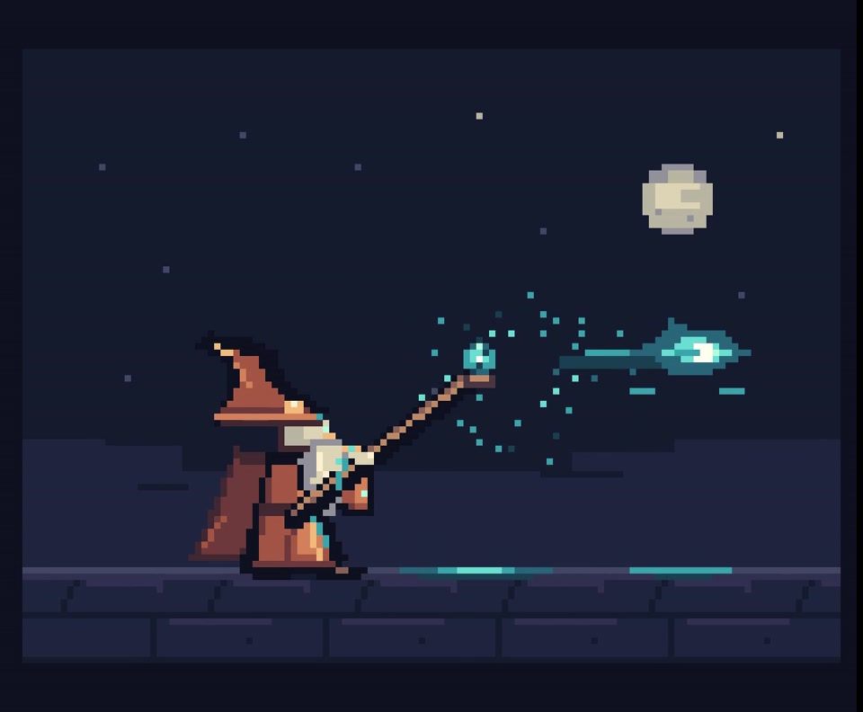
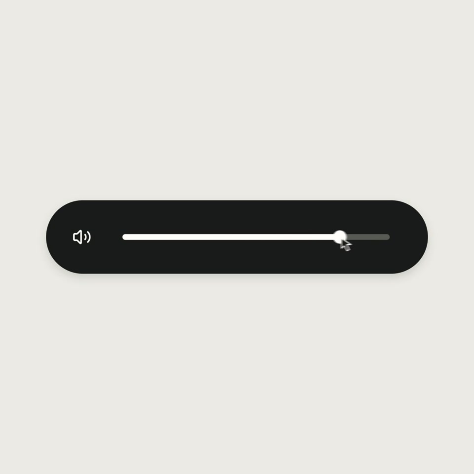

# 实验作品与工艺记录

[外部调研风格库](researched-styles.md)是主选型入口。本页保留实验作品，不将它们冒充调研分类。

画面风格与内容规划分别记录。每个案例提供实际成片、帧预览、工艺、输入条件和可复用指导。以下不是相同提示词的对照，也不代表五种风格全部达到外部参考质量。

## 摄影印刷剪贴 · 留下这一句

摄影裁片 / 印刷宋体 / 纸片箭头 / 有限姿态

[完整成片](../gallery/collage/film.mp4) · [提示词与工艺](../gallery/collage/prompt.md) · [素材署名](../gallery/collage/CREDITS.md)

明确选择剪贴方向的风格样段，不是同提示词盲测。

核对了关键状态和编码；主观听感及连续运动审美未声称验证。

## 平涂图形与群体编排 · PLAY / FORM

实心轮廓 / 形变接力 / 错峰群体 / 负空间

[完整成片](../gallery/shape-play/film.mp4) · [提示词与工艺](../gallery/shape-play/prompt.md) · [素材署名](../gallery/shape-play/CREDITS.md)

视觉初版先独立完成与锁定，经过用户选型；展示的是揭示原片后的声音修订版，整份交付不能称为未看参考直出。

用户认可声音修订有提升；仍未确认达到外部Opus作品质量。

## 立体材质与空间光影 · In Between · 共振的场

薄膜曲面 / 暖金与冷反射 / 空间穿行 / 开放轮廓

[完整成片](../gallery/material-field/film.mp4) · [提示词与工艺](../gallery/material-field/prompt.md) · [素材署名](../gallery/material-field/CREDITS.md)

整片自审和锁定后揭示原片；用户选择B方向，属于额外上下文。影片是艺术想象，不是模型实际主观体验证据。

用户认为概念、意义、整体节奏与外部参考差距明显；公开它作为形式探索及失败案例，不当作成功范式。

## 像素角色与法术表演 · Copper & Cyan

整数像素 / 限定色阶 / 角色受力 / 像素光效

[完整成片](../gallery/pixel-wizard/film.mp4) · [提示词与工艺](../gallery/pixel-wizard/prompt.md) · [素材署名](../gallery/pixel-wizard/CREDITS.md)

已有作品的参考研究后修订，不是新题盲测。查看Saint11教程与此前对标形成额外上下文。

造型与魔法形态修订有可见变化；对标的像素细节及层次仍更丰富。编码60fps不证明所有设备实时稳定60fps。

## 极简UI连续形变 · Soft Signal

单一外壳 / 直接操控 / 闭式弹簧 / 曝光模糊

[完整成片](../gallery/ui-morph/film.mp4) · [提示词与工艺](../gallery/ui-morph/prompt.md) · [素材署名](../gallery/ui-morph/CREDITS.md)

制作时已经查看原片时间采样，属于带参考研究的独立设计，不是盲测。

带参考创作，不支持“从未看原片也能达到相同质量”的结论；这里展示自己的UI文案、布局与图表选择。
