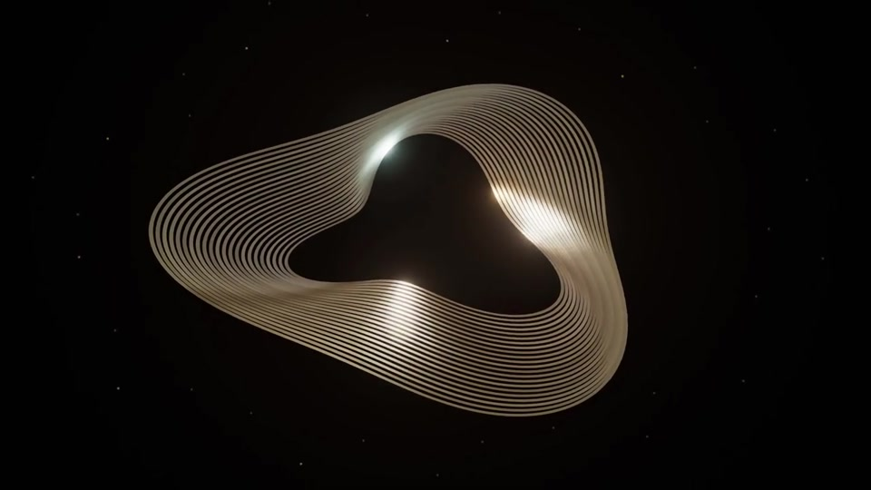

# In Between · 共振的场

立体材质与空间光影 · 薄膜曲面 / 暖金与冷反射 / 空间穿行 / 开放轮廓

[完整成片](film.mp4) · [提示词与工艺](prompt.md) · [素材许可](CREDITS.md)

用户认为概念、意义、整体节奏与外部参考差距明显；公开它作为形式探索及失败案例，不当作成功范式。

本目录是成片展示与设计指导，不是该历史工程的一键复现包；可运行完整工程仍见仓库examples目录。
